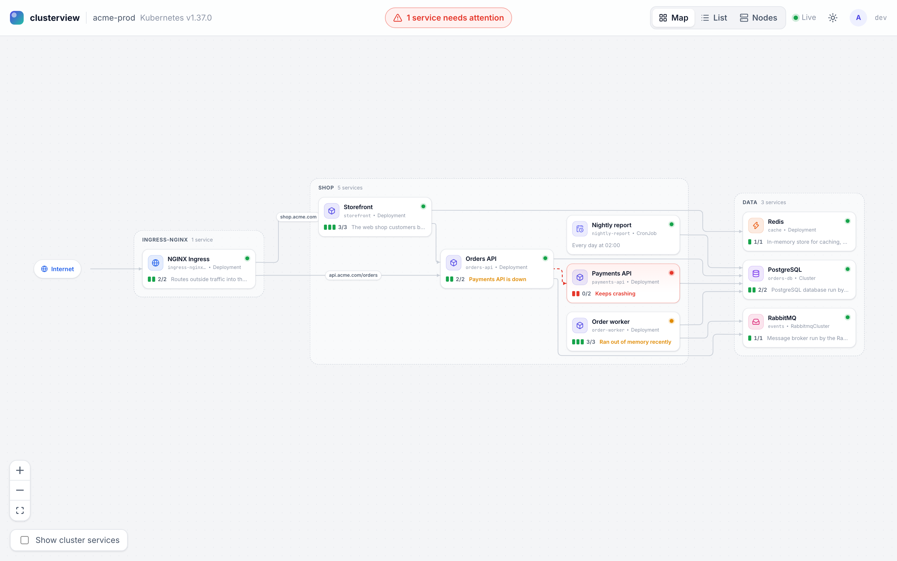
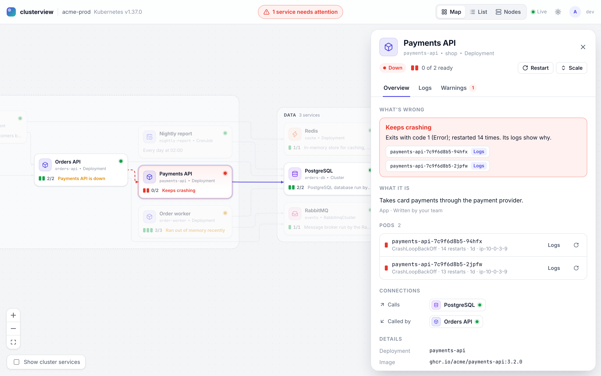
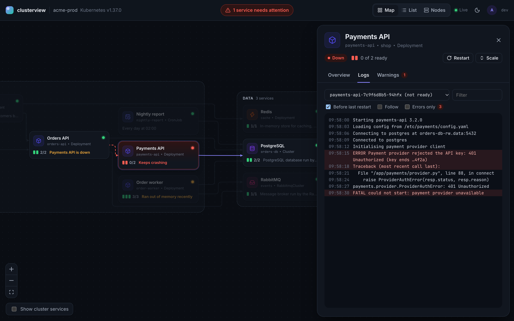
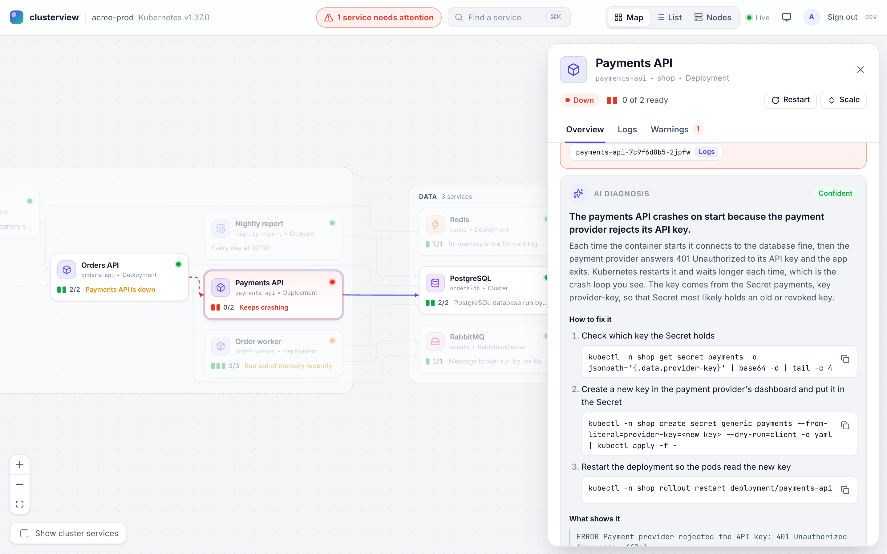
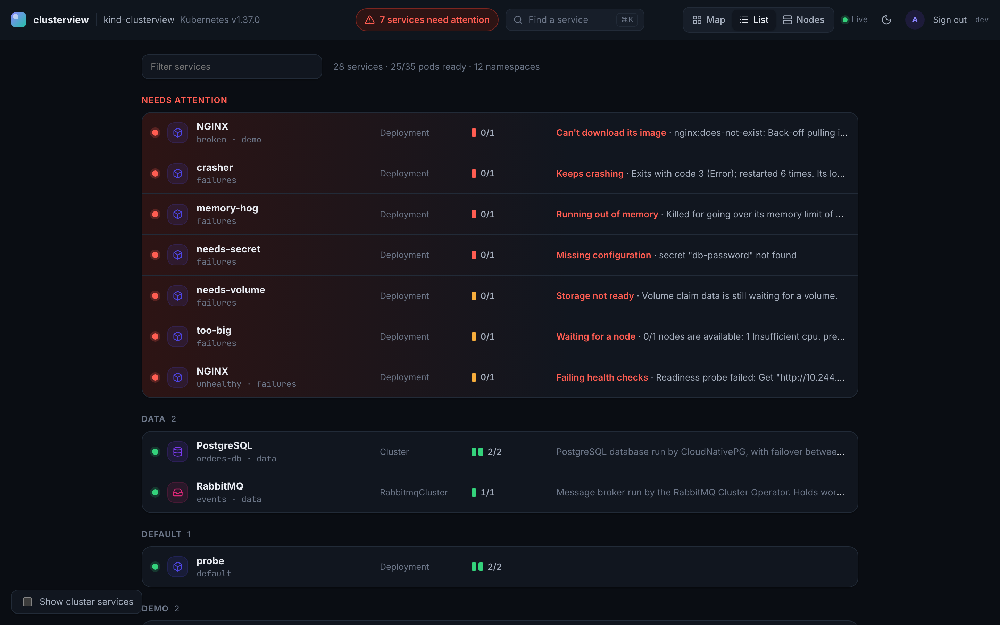
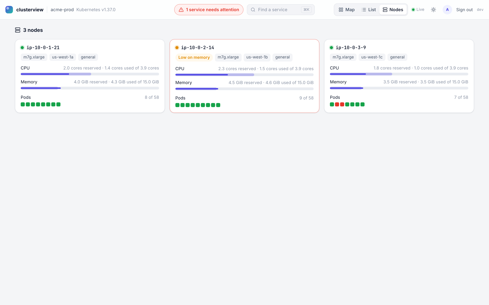

# clusterview

> Working name. Renaming the repo later is cheap.

A simple, good-looking dashboard for any Kubernetes cluster. Every service is a
box. When one breaks, its box turns red and says why. From there you can read
its logs, ask AI to find the error, or restart it.

Installs with one Helm command. Read-only unless you turn actions on.

Status: phases 1–5 of [the plan](docs/PLAN.md) are done: it installs, watches
the cluster live, explains problems in plain words, has the designed UI, and
with your own AI key finds the cause of a failure.



| Click a service | Its logs, error lines highlighted |
|---|---|
|  |  |
| **Find error: the cause, the evidence, the fix** | |
|  | |
| **Everything as a list, trouble first** | **The machines and what runs on them** |
|  |  |

Press **⌘K** (or **/**) to find any service, namespace or pod and jump to it.

## Install

```bash
helm install clusterview oci://ghcr.io/clusterview/charts/clusterview -n clusterview --create-namespace
kubectl -n clusterview port-forward svc/clusterview 8080
```

Then open http://localhost:8080.

Without Helm, apply the `install.yaml` attached to each
[release](https://github.com/clusterview/clusterview/releases):

```bash
kubectl apply -f https://github.com/clusterview/clusterview/releases/latest/download/install.yaml
```

### On your laptop, no install

Download `kubectl-clusterview` for your system from a
[release](https://github.com/clusterview/clusterview/releases), put it on your
`PATH`, and run:

```bash
kubectl clusterview                      # current context, opens your browser
kubectl clusterview --context staging --namespaces shop,payments
```

It uses your kubeconfig and your own permissions, listens on `127.0.0.1`
only (port 8080, or a free one), and stops when you press Ctrl+C. The
`clusterview` binary is the same program; it opens the browser only with
`--open`.

### Only some namespaces

```bash
helm install clusterview oci://ghcr.io/clusterview/charts/clusterview -n clusterview --create-namespace \
  --set 'scope.namespaces={shop,payments}'
```

clusterview then watches only those namespaces, with a Role in each instead
of cluster-wide read access. The nodes view keeps a small ClusterRole (nodes
and their metrics only); turn it off with `scope.nodes=false`. Actions are
limited to the watched namespaces unless `actions.namespaces` narrows them
further.

### What it can access

By default the chart creates a ClusterRole that can **read** workloads, pods,
pod logs, events, nodes, Services, Ingresses, volumes, autoscalers, CRD
definitions and metrics. It cannot read Secrets or ConfigMaps, exec into
pods, or change anything. See
[`charts/clusterview/templates/rbac.yaml`](charts/clusterview/templates/rbac.yaml).

### Actions

Off by default. Switch them on to restart pods, restart and scale workloads,
and run CronJobs now:

```bash
helm upgrade clusterview oci://ghcr.io/clusterview/charts/clusterview -n clusterview \
  --reuse-values --set actions.enabled=true
```

| Action | What it does | Refused when |
|---|---|---|
| Restart pod | Deletes the pod so its owner replaces it | Nothing owns the pod, or it's a static pod |
| Restart | Rolling restart of a Deployment, StatefulSet or DaemonSet, like `kubectl rollout restart` | The Deployment is paused |
| Scale | Sets a Deployment's or StatefulSet's replicas | An autoscaler owns the count, or it's over `actions.maxReplicas` (20) |
| Run now | Starts a Job from a CronJob, like `kubectl create job --from` | — |

The chart then adds only those rights: get/delete pods, get/patch
Deployments, StatefulSets and DaemonSets, list autoscalers, get CronJobs,
create Jobs and Events. It never grants deleting workloads, Secrets or exec.
`actions.namespaces` limits actions (and the chart's grants) to a list of
namespaces.

Every action, refused or failed ones included, goes to the **audit log**: the
process log as JSON, `GET /api/v1/audit` (the last 500), and a
`ClusterviewAction` Event on the object, so `kubectl describe` shows who did
what. Action requests must carry an `X-Clusterview-Action` header, which a
browser won't send cross-site.

### Sign-in and roles

| `auth.mode` | Who's signed in | Use it when |
|---|---|---|
| `none` (default) | Nobody; everyone may act (if actions are on) | You reach it with `kubectl port-forward`, so only people with cluster access can |
| `proxy` | Whoever an auth proxy says, from `X-Forwarded-Email` and `X-Forwarded-Groups` | oauth2-proxy, Pomerium, or an ingress `auth-url` sits in front. Keep the dashboard reachable only through the proxy (`networkPolicy`), or anyone could send those headers |
| `oidc` | People who sign in with your OpenID Connect provider (Okta, Entra ID, Google, Keycloak, Dex…) | You expose it with an ingress |

`auth.viewers` may look and `auth.operators` may also act. Entries are a user
(`ann@example.com`), `group:<name>`, `*@<domain>` or `*`. An empty viewers
list lets anyone signed in look; an empty operators list lets nobody act
(except in mode `none`). Actions record the signed-in person in the audit log.

OIDC example:

```bash
kubectl -n clusterview create secret generic clusterview-auth \
  --from-literal=clientSecret=... --from-literal=sessionKey="$(openssl rand -hex 32)"
helm upgrade clusterview oci://ghcr.io/clusterview/charts/clusterview -n clusterview --reuse-values \
  --set auth.mode=oidc \
  --set auth.oidc.issuerURL=https://login.example.com \
  --set auth.oidc.clientID=clusterview \
  --set auth.oidc.redirectURL=https://clusterview.example.com/auth/callback \
  --set auth.existingSecret=clusterview-auth \
  --set 'auth.viewers={*@example.com}' --set 'auth.operators={group:platform}'
```

Sign-in uses the authorization code flow with PKCE, state and nonce. The
session is a signed, HttpOnly, SameSite=Lax cookie (Secure over https) that
lasts 12 hours. Without a `sessionKey`, a restart signs everyone out.

### Find error (AI)

Off until you bring a key. Then a broken service's drawer gets a **Find
error** button: clusterview gathers what Kubernetes knows about it (its
problems, pod and container states, a summary of the pod spec, recent
warnings, and the last 80 lines of its logs, from before the last restart
too), removes anything that looks like a secret, and asks the model for the
cause in plain words, the lines that show it, and the steps to fix it.

```bash
kubectl -n clusterview create secret generic clusterview-ai --from-literal=apiKey=sk-ant-...
helm upgrade clusterview oci://ghcr.io/clusterview/charts/clusterview -n clusterview --reuse-values \
  --set ai.provider=anthropic --set ai.existingSecret=clusterview-ai
```

| `ai.provider` | Model | Key |
|---|---|---|
| `anthropic` | `claude-opus-5-5` unless `ai.model` says otherwise | `apiKey` in `ai.existingSecret` |
| `openai` | `ai.model`, required | `apiKey` in `ai.existingSecret` |
| `openai` with `ai.baseURL` | Any OpenAI-compatible server: Ollama, vLLM, LM Studio (`http://ollama.ollama:11434/v1`) | Usually none |

On a laptop: `kubectl clusterview --ai-provider=anthropic` reads
`ANTHROPIC_API_KEY` (or `OPENAI_API_KEY` for openai).

What leaves the cluster, and only when someone presses the button:

- Never Secret values: variables from Secrets show only the Secret's name,
  and variables with secret-sounding names (`*PASSWORD*`, `*TOKEN*`,
  `*KEY*`…) show only that they're set.
- Logs, events and other values pass through a filter that replaces keys,
  tokens, JWTs, passwords in URLs and `name=value` pairs that sound secret
  with `[REDACTED]`. It errs on the side of removing too much.
- The answer has a **What was sent** section showing exactly what the model
  got, and how many values were hidden.

Answers are kept 5 minutes per service (**Ask again** skips that), and at most
three run at once. The request needs the `X-Clusterview-Action` header, so
another site can't spend your key through someone's browser.

With AI on, clusterview also describes services nothing else can (see
[Services and descriptions](#services-and-descriptions)) from their image
paths, registry removed, marked **AI guess**. Only the image path is sent.
Base images (busybox, alpine, python…) get no guess, because their name
says nothing about the service. Turn guesses off with
`ai.describeServices=false`.

To check Find error against five known failures (a crash loop, out of memory,
a bad image, missing config, a failing probe), see
[`test/eval/failures.yaml`](test/eval/failures.yaml) and
[`hack/find-error-eval.sh`](hack/find-error-eval.sh).

### Alerts

Optionally notify Slack, Teams or a custom webhook when a service stays
broken. By default it waits five minutes, sends one alert, and sends a
recovery when the service is healthy again. Normal rollouts and brief
failures stay quiet. It uses the namespaces the dashboard already watches,
needs no extra Kubernetes permissions, and doesn't call AI.

Put the destination URL in a Secret with a `webhookURL` key, then configure
the chart (see the [alert setup and behavior](docs/features/service-alerts.md)):

```bash
helm upgrade clusterview oci://ghcr.io/clusterview/charts/clusterview -n clusterview \
  --reuse-values --set alerts.enabled=true --set alerts.existingSecret=clusterview-alerts \
  --set alerts.format=slack --set alerts.for=5m --set alerts.cluster=production \
  --set alerts.dashboardURL=https://clusterview.example.com
```

`alerts.format` is `slack`, `teams` (an Adaptive Card for a Teams webhook
workflow), or `webhook` (structured JSON). Alerts include the service's name,
namespace, health, replica counts and plain problem titles. They contain
no logs, pod specs, environment values or raw Kubernetes event messages.

On a laptop set `CLUSTERVIEW_ALERTS_WEBHOOK_URL` in the environment and use
`--alerts-format=slack --alerts-for=5m --alerts-cluster=staging`. The URL is
read only from the environment because webhook URLs contain credentials.

Incident tracking is in memory: a restart starts a new five-minute window.
Failed deliveries retry with backoff; HTTP 429 pauses the destination and
honors `Retry-After` up to one hour. Successful alerts aren't repeated while
the service stays broken. A retry after a lost response can still duplicate
a message; custom receivers can deduplicate using the `Idempotency-Key` header.

### Settings

See [`charts/clusterview/values.yaml`](charts/clusterview/values.yaml).
Invalid settings fail at install time thanks to `values.schema.json`.

## Develop

You need Go (see `go.mod`), Node 24, Docker, Helm and kind.

| Command | What it does |
|---|---|
| `make web build` | Build the UI, then the binary with the UI inside it |
| `make run` | Run the binary against your current kubeconfig context |
| `cd web && npm run dev` | UI with hot reload on :5173, calling the binary on :8080 |
| `http://localhost:5173/?mock=demo` | The UI on fixture data, no cluster needed (`?mock=kind` for a cluster with a lot broken; add `&theme=dark`, `&select=<service id>`, `&tab=logs`) |
| `make test lint chart-lint` | Tests and linters, as CI runs them |
| `make kind-up kind-install` | Create a local kind cluster and install the chart from your working tree |
| `make kind-down` | Delete that cluster |

## API

| Endpoint | What it returns |
|---|---|
| `GET /api/v1/snapshot` | Every service (one box on the map) and the workloads behind it: Deployments, StatefulSets, DaemonSets, Jobs, CronJobs, and pods nothing else owns, with pods, health, replicas and autoscaling |
| `GET /api/v1/nodes` | Every node: capacity, reserved and used CPU/memory, pressure, pods; plus pods waiting for a node |
| `GET /api/v1/events` | Server-Sent Events: a `version` event whenever the cluster changes |
| `GET /api/v1/namespaces/{ns}/pods/{pod}/logs` | A container's recent log (`container`, `previous`, `tailLines`, `sinceTime`) |
| `GET /api/v1/namespaces/{ns}/pods/{pod}/logs/follow` | The same log streamed live as `line` events |
| `POST /api/v1/namespaces/{ns}/pods/{pod}/restart` | Restart a pod (actions on) |
| `POST /api/v1/workloads/{kind}/{ns}/{name}/restart` | Rolling restart (actions on) |
| `POST /api/v1/workloads/{kind}/{ns}/{name}/scale` | Scale, body `{"replicas": n}` (actions on) |
| `POST /api/v1/workloads/CronJob/{ns}/{name}/run` | Run a CronJob now (actions on) |
| `GET /api/v1/actions`, `/api/v1/audit` | Action limits; the audit log |
| `GET /api/v1/me` | Who you are and your role |
| `GET /api/v1/ai` | Whether Find error is on, and with which model |
| `POST /api/v1/diagnose` | Find error, body `{"serviceId": "...", "fresh": false}` (AI on) |
| `GET /auth/login`, `/auth/callback`, `/auth/logout` | OIDC sign-in (mode `oidc`) |
| `GET /api/v1/cluster`, `/api/v1/version` | Connection status and build info |
| `GET /healthz`, `/readyz` | Liveness; readiness once the first full read of the cluster is in memory |

The binary watches the cluster with Kubernetes informers, so it reads
everything once and then only receives changes. Changes are grouped for
250 ms and announced on `/api/v1/events`. CI checks that a change shows up in
the API within 2 seconds.

## Services and descriptions

clusterview groups workloads into **services**, the boxes on the map:

- A workload an operator runs becomes one service per custom resource. A
  `RabbitmqCluster`'s StatefulSet and a CloudNativePG `Cluster`'s pods each
  show as one service, named after the resource.
- A chart's helper Jobs (install hooks) join the service they belong to.
- Everything else is one service per workload.

Each service gets a title, a one-line description and a category, from the
first of:

1. Your annotations on the workload or its pod template:

   ```yaml
   metadata:
     annotations:
       clusterview.io/title: Checkout
       clusterview.io/description: Takes payment and creates the order.
       clusterview.io/category: app   # app, database, queue, cache, search, storage,
                                      # ingress, network, dns, monitoring, security, platform, job
   ```

2. The operator that runs it (RabbitMQ, CloudNativePG, Strimzi, Elastic…).
3. A catalogue of well-known images (PostgreSQL, Redis, NGINX Ingress, CoreDNS…).

4. With [AI](#find-error-ai) on, the model's guess from the image name,
   marked **AI guess**. It's asked once per image, in the background.

Without any of these the title is the Kubernetes name and there's no
description. The catalogue is in
[`internal/cluster/catalog.go`](internal/cluster/catalog.go).

## Problems in plain words

Every workload and service carries a list of **problems**, critical first,
each with a plain title and Kubernetes' own evidence:

| Problem | When |
|---|---|
| Can't download its image | `ImagePullBackOff`, `ErrImagePull`, `InvalidImageName` |
| Missing configuration | `CreateContainerConfigError`, such as a missing Secret or ConfigMap |
| Can't start | `CreateContainerError`, `RunContainerError` |
| Running out of memory | Killed by the memory limit (`OOMKilled`), now or before its last restart |
| Keeps crashing | `CrashLoopBackOff`, with the exit code and restart count |
| Stopped with an error | Exited non-zero and won't be restarted (Jobs) |
| A setup step is failing | Any of the above in an init container |
| Waiting for a node | Unschedulable, with the scheduler's reason |
| Storage not ready | Its volume claim is missing or still pending |
| Failing health checks | Running but not ready, with the failing probe's message |
| Its node is down | Its node isn't Ready |
| Evicted from its node | Evicted, with the reason |
| Update stuck | A Deployment's rollout passed its progress deadline |
| Can't create pods | `ReplicaFailure`, or `FailedCreate` warnings (quota, admission) |
| Failed / Last run failed | A Job or a CronJob's latest run failed |
| Restarted recently, Ran out of memory recently | Running now, but restarted in the last hour (warning) |
| At its scaling limit | Its autoscaler is at its maximum (warning) |

Recent **warning events** (the last hour) for each workload and its pods are
listed too. clusterview only watches Warning events.

## How services connect

- **Addresses:** the Kubernetes Services whose selector reaches a service's
  pods, with ports, type and any load balancer address.
- **From outside:** Ingress rules that lead to it (host, path, TLS, class).
- **Links:** a service calls another when its pod template names the other's
  Service address in an environment variable's literal value or its
  command-line arguments. `orders-db-rw.data.svc:5432` in `DATABASE_URL`
  links to the PostgreSQL behind that Service. A bare name (`redis`) only
  counts in a URL, as `host:port`, or as the whole value of an address-like
  variable (`*_HOST`, `*_URL`, `*_ADDR`…). Values from Secrets and ConfigMaps
  are never read, so addresses kept there don't produce links.

## Layout

```
cmd/clusterview/      entry point (in-cluster or kubeconfig)
internal/api/         HTTP API, event streams and UI serving
internal/cluster/     watches, workloads and health, nodes, logs
internal/ai/          model providers, secret redaction, AI descriptions
internal/alerts/      sustained-failure alerts, recovery and webhook delivery
internal/diagnose/    Find error: gathers the evidence and asks the model
internal/kube/        cluster connection
web/                  React + Vite UI, embedded into the binary
charts/clusterview/   Helm chart
.github/workflows/    CI (lint, test, kind install) and release
```

## Release

Push a tag like `v0.1.0`. The release workflow publishes:

- `clusterview` and `kubectl-clusterview` binaries for macOS, Linux and
  Windows (amd64 and arm64), with checksums

- the multi-arch image `ghcr.io/clusterview/clusterview:0.1.0`, signed with
  cosign and carrying an SBOM
- the chart `oci://ghcr.io/clusterview/charts/clusterview` at version `0.1.0`
- `install.yaml` on the GitHub release

The image and chart are public: installing needs no login.

## License

[Apache-2.0](LICENSE).
